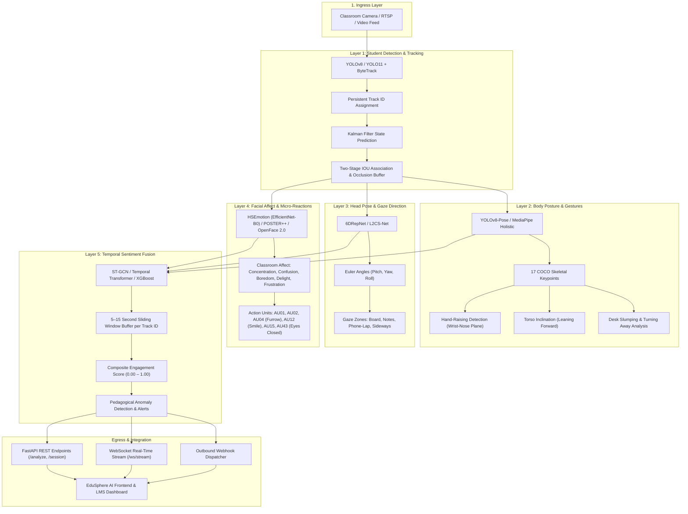

# Modular Model Stack Architecture
## Pedagogical & Behavioral Analytics Engine

An end-to-end multi-stage deep vision pipeline engineered for high-density lecture halls and classrooms. It tracks individual student trajectories, postural kinetics, head orientation, micro-affective indicators, and fuses them over a temporal sliding window.

---

## 1. System Architecture Overview



---

## 2. Detection & Behavioral Layers Specification

### Layer 1: Student Detection & Tracking
- **Models**: `YOLOv8` / `YOLO11` + `ByteTrack`
- **Objective**: Isolates individual students in dense, multi-row lecture halls and assigns persistent track IDs across frames.
- **Occlusion Handling**: Two-stage association algorithm. Unmatched high-score detections are first paired with existing Kalman tracks; low-score detections are retained to bridge brief occlusions (students passing in front, sitting behind tall seats) up to `track_buffer=30` frames before retirement.

### Layer 2: Body Posture & Gestures
- **Models**: `YOLOv8-Pose` / `MediaPipe Holistic`
- **Objective**: Tracks 17 skeletal keypoints (shoulders, elbows, wrists, hips, head).
- **Target Cues**:
  - `HAND_RAISING`: Wrist $y$-coordinate elevated significantly above the nose horizontal plane ($\Delta y > 15\text{px}$). Indicates active inquiry.
  - `LEANING_FORWARD`: Torso vector angle $> 18^\circ$ tilted forward toward lecturer. Indicates high engagement.
  - `SLUMPING_SLEEPING`: Head-to-shoulder vertical distance ratio collapsing below threshold ($< 0.10$). Indicates physical disengagement or sleeping on desk.
  - `TURNING_AWAY`: Shoulder horizontal span compression indicating lateral body rotation ($> 35^\circ$).

### Layer 3: Head Pose & Gaze Direction
- **Models**: `6DRepNet` / `L2CS-Net`
- **Objective**: Continuous Euler angle regression ($\text{Pitch } \theta, \text{Yaw } \psi, \text{Roll } \phi$).
- **Gaze Target Mapping**:
  - `BOARD_LECTURER`: $\psi \in [-22^\circ, 22^\circ], \theta \in [-15^\circ, 15^\circ]$ (Attending to slides/instructor).
  - `NOTEBOOK_DESK`: $\theta \in [-45^\circ, -15^\circ], \psi \in [-30^\circ, 30^\circ]$ (Taking notes / reading material).
  - `PHONE_LAP_DISTRACTED`: $\theta < -45^\circ$ (Looking down at lap/under desk).
  - `SIDEWAYS_DISTRACTED`: $|\psi| > 30^\circ$ (Interacting with peers / looking away).

### Layer 4: Facial Affect & Micro-Reactions
- **Models**: `HSEmotion (EfficientNet-B0)`, `POSTER++`, `OpenFace 2.0`
- **Objective**: Classroom-specific affective state classification and Facial Action Unit (AU) intensity.
- **Target States & Action Units**:
  - `Concentration`: AU04 (corrugator mild contraction), focused gaze, neutral lip posture.
  - `Confusion`: High AU04 (brow lowerer) + AU01 (inner brow raiser) + AU15 (lip depressor). Represents cognitive challenge.
  - `Boredom / Fatigue`: AU43 (eyes closed/drooping) + neutral/low muscle tone.
  - `Delight`: AU12 (lip corner puller) + AU06 (cheek raiser). Concept comprehension and positive reinforcement.
  - `Frustration`: High AU04 + AU15 + negative posture shifts.

### Layer 5: Temporal Sentiment Fusion
- **Models**: `ST-GCN (Spatio-Temporal Graph Convolutional Network)`, `Temporal Transformer`, `XGBoost`
- **Sliding Window**: Configurable between **5.0 to 15.0 seconds** (default 10.0s).
- **Feature Vector $X_t$**:
  $$X_t = [Gaze\_Score_t, Affect\_Weight_t, Posture\_Score_t, Motion\_Velocity_t]$$
- **Composite Engagement Formula**:
  $$E_{window} = w_{att} \cdot S_{attention} + w_{aff} \cdot S_{affect} + w_{pos} \cdot S_{posture}$$
  Where default weights are $w_{att} = 0.40, w_{aff} = 0.35, w_{pos} = 0.25$.
- **Pedagogical Alerts**:
  - `CLASSROOM_ALERT: High Confusion Spike`: Triggered if $> 30\%$ of the class displays confusion concurrently.
  - `PEDAGOGICAL_PROMPT`: Triggered when $\ge 1$ students raise hands.
  - `PERSISTENT_DISENGAGEMENT`: Flags students with prolonged phone or sleeping states ($> 8\text{s}$).

---

## 3. Communication & Integration Interfaces

```
+-------------------------------------------------------------------------+
|                  Modular Pedagogical Vision Engine                      |
|                                                                         |
|  [REST API: Port 8088]               [WebSocket: Port 8088]             |
|  POST /api/v1/analyze/frame          ws://host:8088/ws/stream/:session  |
|  POST /api/v1/session/start                                             |
|  POST /api/v1/session/:id/frame      [Outbound Event Webhooks]          |
|  GET  /api/v1/session/:id/metrics    POST -> https://lms.domain/webhook |
|  POST /api/v1/session/:id/stop                                          |
+-------------------------------------------------------------------------+
                                   ▲
                                   │
+----------------------------------┴--------------------------------------+
|                     External Consumer Modules                           |
|                                                                         |
|  • EduSphere AI Frontend (React 18 + Express)                           |
|  • Python Client SDK (EduVisionClient)                                  |
|  • CCTV / IP Cameras (RTSP ffmpeg ingress)                              |
|  • LMS Plugins (Moodle, Canvas, Blackboard)                            |
+-------------------------------------------------------------------------+
```
